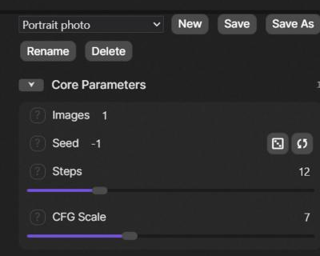

# SwarmUI-Workspaces

A SwarmUI extension for saving and restoring named workspaces: snapshots of your Generate-tab settings, including which parameter groups are switched on.

## Status

In development. Working now: the server API (create, update, rename, delete, import), capturing and restoring the Generate tab, and a toolbar above the parameters. Also working: partial load, and JSON export and import. Not built yet: folders and tags, drafts.

## Using it

The toolbar sits above the parameter list on the Generate tab:

- **Dropdown**: pick a workspace to load it. A load replaces your current settings completely. If the current workspace has unsaved changes, you are asked first.
- **New** saves the current settings as a new workspace. **Save As** does the same, starting from "<name> copy".
- **Save** writes the current settings into the selected workspace. If it was changed elsewhere, nothing is overwritten and you are told.
- **Reload** throws away unsaved changes and loads the latest saved version of the selected workspace, for example after it was changed elsewhere.
- **Load Part...** opens a dialog to load only some parts of a workspace: the model, the presets, or any parameter group. Only the ticked parts change, and everything else stays as it is. If you tick a group that is switched on inside a parent group that is off, the parent is switched on too, and you are told. The settings then count as modified, because they no longer match the workspace.
- **Export** downloads the saved version of the selected workspace as a JSON file, and **Export All** downloads every workspace. **Import** adds the workspaces from such a file. The whole file is checked first, and either every workspace is added or none are. Imported workspaces get fresh IDs, and a name that is already taken gets a number added.
- **Shift+S** saves, like the Save button. It does nothing while you are typing in a field, and while a dialog or the image editor is open.
- **Drafts**: while the selected workspace has unsaved changes, a draft of them is kept in your browser a couple of seconds after each change. If you reload the page or close the tab, a notice at the top of the toolbar offers to **Restore** or **Discard** it. Restoring loads the workspace first and then puts the draft on top, so it shows as unsaved changes and never overwrites the saved workspace. Each browser tab keeps its own draft, and a draft from a tab that is still open is never offered.
- **Rename** and **Delete** act on the selected workspace. Delete leaves your settings as they are.
- **Modified** appears when the settings differ from the selected workspace, and goes away only after a successful save or load.





## Installation

Clone into your SwarmUI extensions folder, then restart SwarmUI:

```bash
cd SwarmUI/src/Extensions
git clone https://github.com/HartsyAI/SwarmUI-Workspaces.git Workspaces
```

## Data and connections

- Workspaces are stored per user on the SwarmUI server, in that user's generic data.
- The extension makes no external network connections.
- Workspaces are stored in SwarmUI's account database, so they are lost if that database is lost.

## License

MIT. See [LICENSE](LICENSE).
