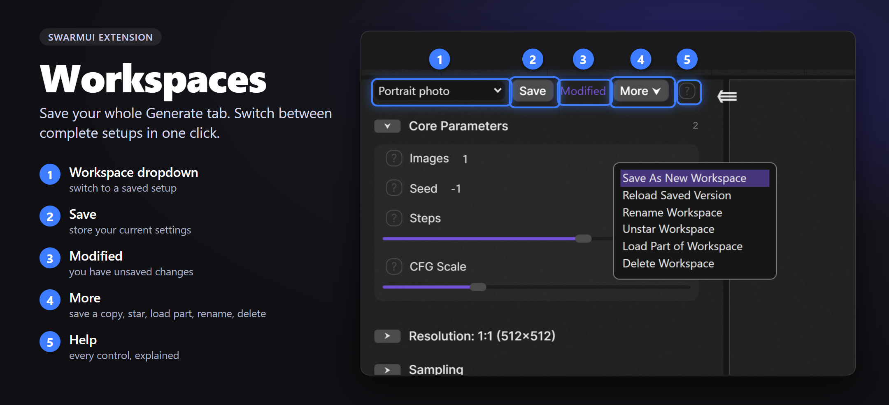

Save your whole Generate tab as a named **workspace**, then switch between complete setups in one click. A preset sets only the parameters you tick and stacks on what you have; a workspace replaces everything: every value, each on/off switch, each group switch, and which presets are active.

## Install

In SwarmUI, open **Server > Extensions**, find **Workspaces**, click **Install**, and restart SwarmUI.

## Use it

A toolbar sits at the top of the Generate tab's parameter list. The **?** beside it explains every control.

1. Set up the Generate tab, click **Save**, and give it a name.
2. Change something and a **Modified** marker appears. **Save** (or **Shift+S**) keeps the change. Picking another workspace, or **More > Reload Saved Version**, throws it away after asking.
3. **More > Save As New Workspace** makes a variation and leaves the original untouched.
4. Switch with the dropdown. **More > Star Workspace** lists your favorites first.
5. **More > Load Part of Workspace** applies only the parts you tick (the model, the presets, any group) and leaves everything else as it is.

   

6. Closed the tab by accident? Unsaved changes are kept in your browser, and a notice offers to **Restore** or **Discard** them.

   

The toolbar uses SwarmUI's own controls, so it follows your theme.

## What is saved

Every parameter value (including ones switched off), each parameter's and group's on/off switch, and the active presets in order. Not saved: image, audio and video inputs, custom Comfy workflows, prompt attachments, and image editor state. A random seed (-1) stays random.

Loading checks everything first and never reports success when something was skipped. It refuses (changing nothing) if a custom workflow, init image, mask or the image editor is in use, or if the saved model is missing. A changed or missing preset asks before continuing. If a load fails part-way, your previous settings are put back.

## Limits and data

- Per user: 200 workspaces, 256 KB each, 4 MB in total, names up to 100 characters (plain text only). The permission is "[Workspaces] Manage Workspaces", which users have by default.
- Workspaces are stored in each user's own data on the SwarmUI server. An account can only ever see its own, and nothing is shared or sent anywhere else. Anyone who can read SwarmUI's database (a server admin) can read them, as with all account data.
- Unsaved-change drafts, which include your prompts, are kept in your browser for up to 14 days. On a shared computer, finish with Save or Discard.
- With `--no_persist`, nothing can be saved, and saving says so.

## License

MIT. See [LICENSE](LICENSE).
