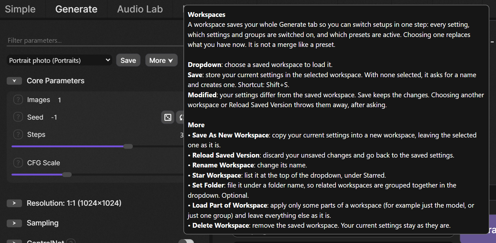
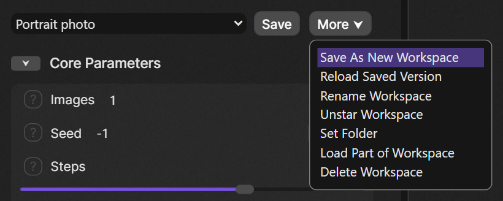
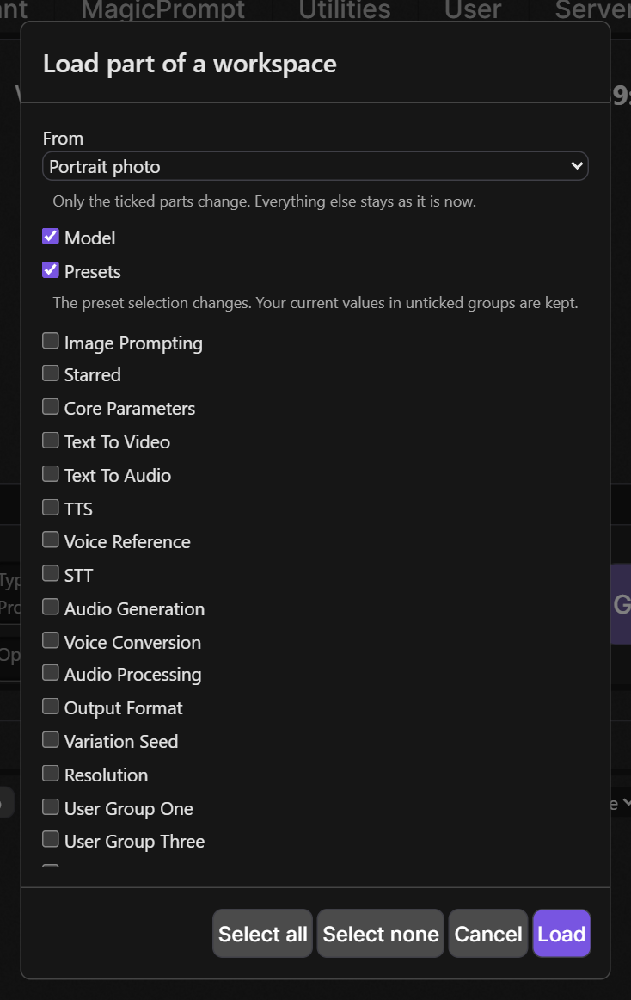
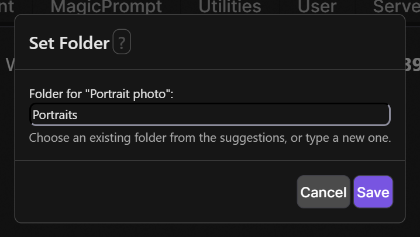

# SwarmUI-Workspaces

A SwarmUI extension for saving and restoring named workspaces: snapshots of your Generate-tab settings, including which parameter groups are switched on.

**Workspaces and presets.** A preset sets only the parameters you ticked and stacks on top of what you have. A workspace replaces everything: every value, each parameter's on/off switch, each group switch, and which presets are active. Use presets for reusable tweaks and workspaces to jump between whole setups. Workspaces use presets, never replace them: a workspace remembers which presets were active and re-selects them when loaded.

## Status

Early release. Everything described below works. It has been tested by hand in the browser against a SwarmUI dev build. The one automated check is `tests/two-user-isolation.mjs` (run it against a throwaway SwarmUI, see the file header): it proves that one account cannot see or change another account's workspaces. Please report anything odd.

## Using it

One row sits above the parameter list on the Generate tab: **[ workspace dropdown ] [ Save ] [ More ] [ ? ]**. The **?** is SwarmUI's usual help button and explains every control in plain language.




When the settings differ from the saved workspace, a "Modified" marker appears:


- **Picker**: a standard SwarmUI dropdown of your workspaces, grouped as Starred, then one group per folder, then Unfiled (a flat list if you use neither). Choosing a workspace replaces your current settings completely, and asks first if the current workspace has unsaved changes. With no workspace selected, Save asks for a name and creates one.
- **Save** writes the current settings into the selected workspace (or asks for a name if none is selected). Shift+S does the same, except while you are typing in a field or a dialog or the image editor is open. If the workspace was changed elsewhere, nothing is overwritten and you are told.
- **Modified** appears when the settings differ from the selected workspace, and goes away only after a successful save or load.
- **More** holds everything else: Save As New Workspace, Reload Saved Version, Rename Workspace, Star Workspace, Set Folder, Load Part of Workspace, and Delete Workspace.



### More detail

- **Save As New Workspace** copies the folder (not the star). **Reload Saved Version** throws away unsaved changes and loads the latest saved version, for example after it was changed elsewhere. **Delete Workspace** leaves your current settings as they are.
- **Load part of a workspace** opens a dialog to load only some parts: the model, the presets, or any parameter group. Only the ticked parts change, and everything else stays as it is. If you tick a group that is switched on inside a parent group that is off, the parent is switched on too, and you are told. The settings then count as modified, because they no longer match the workspace.





- **Star Workspace** lists a workspace first. **Set Folder** opens a small dialog where you type a folder name (at most 100 characters) or pick one you already use, to group related workspaces in the dropdown. It is optional, and leaving it empty means no folder. Saving settings never changes a workspace's folder or star.
- **Drafts**: while the selected workspace has unsaved changes, a draft of them is kept in your browser a couple of seconds after each change. If you reload the page or close the tab, a notice below the toolbar offers to **Restore** or **Discard** it. Restoring loads the workspace first and then puts the draft on top, so it shows as unsaved changes and never overwrites the saved workspace. Each browser tab keeps its own draft, and a draft from a tab that is still open is never offered.

## What a workspace saves, and what loading does

A workspace saves the Generate tab's parameter values (including values you have configured but switched off), each parameter's own on/off switch, every parameter group's switch (nested groups too), and the active presets in order. Loading replaces all of that; it is not a merge like a preset.

Not saved: image, audio and video inputs (init image, mask, reference images), custom Comfy workflows, prompt attachments, and image editor state. A seed set to random (-1) is saved as -1, so it still picks a new seed each time. A workspace cannot bring back a model or preset that no longer exists.

Loading is careful:

- It checks the whole workspace first, and refuses a workspace from a newer version of this extension.
- It refuses to load while a custom workflow, init image, mask or the image editor is in use, because loading would leave that state in place. Nothing is changed.
- If the workspace's model is not available, it refuses and nothing is changed.
- If a saved preset is missing or has changed since, it asks before continuing.
- It never reports success when something was skipped: items that could not be restored are listed.
- If an error happens part-way, it puts your previous settings back. If even that fails, a notice above the parameters says the settings are a mix and should be checked.

## Limits and permissions

- Per user: up to 200 workspaces, each snapshot up to 256 KB, 4 MB of workspaces in total, names up to 100 characters.
- Listing, saving and deleting workspaces needs the permission "[Workspaces] Manage Workspaces", which regular users have by default.
- If SwarmUI runs with `--no_persist`, nothing can be saved, and saving says so instead of pretending to work.

## Installation

Clone into your SwarmUI extensions folder, then restart SwarmUI:

```bash
cd SwarmUI/src/Extensions
git clone https://github.com/HartsyAI/SwarmUI-Workspaces.git Workspaces
```

## Data and connections

- Workspaces are stored per user on the SwarmUI server, in that user's own generic data (keyed by their account ID). The server takes the user from the logged-in session on every request and never from anything the browser sends, so one account cannot list, read, change or delete another account's workspaces, and there is no sharing feature. Each save is read back to confirm it was really stored; if SwarmUI skipped the write, you are told instead of seeing a false success.
- While you have unsaved changes, a draft of them (which includes your prompts) is kept in your browser's local storage, under a key for that server and your account. It is never offered to another account, nothing is written before SwarmUI has told the page who you are, and drafts older than 14 days are removed. On a shared computer, finish with Save or Discard, or use a private window.
- The extension makes no external network connections.
- Earlier builds could also store tags and thumbnails. They are no longer used or shown, and the leftover data is harmless.
- Workspaces are stored in SwarmUI's account database, so they are lost if that database is lost, and anyone who can read that database (a server administrator) can read them, as with all SwarmUI account data.

## License

MIT. See [LICENSE](LICENSE).
