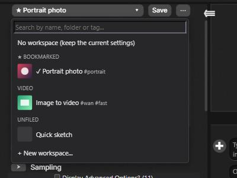
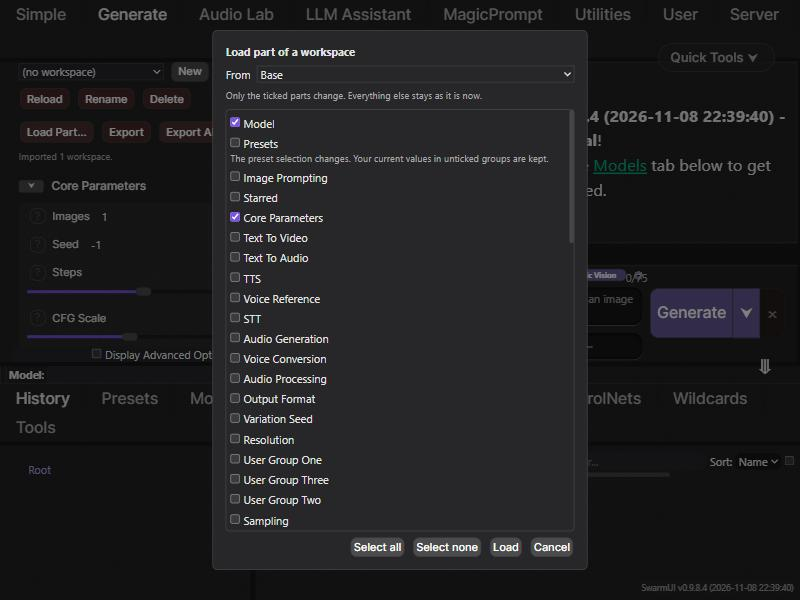

# SwarmUI-Workspaces

A SwarmUI extension for saving and restoring named workspaces: snapshots of your Generate-tab settings, including which parameter groups are switched on.

## Status

In development. Working now: the server API (create, update, rename, delete, import), capturing and restoring the Generate tab, and a toolbar above the parameters. Also working: partial load, JSON export and import, folders, tags, search, bookmarks, drafts, and the Shift+S shortcut. Thumbnails are included.

## Using it

One row sits above the parameter list on the Generate tab: **[ workspace picker ] [ Save ] [ ... ]**.


- **Picker**: click it to open a searchable list of your workspaces, grouped by bookmark, then folder. Type to filter by name, folder or tag, and press Enter to load the first match. Choosing a workspace replaces your current settings completely, and asks first if the current workspace has unsaved changes. "+ New workspace..." at the bottom saves the current settings under a new name.
- **Save** writes the current settings into the selected workspace (or asks for a name if none is selected). Shift+S does the same, except while you are typing in a field or a dialog or the image editor is open. If the workspace was changed elsewhere, nothing is overwritten and you are told.
- **Modified** appears when the settings differ from the selected workspace, and goes away only after a successful save or load.
- **...** holds everything else: Save As, Reload saved version, Rename, Bookmark, Folder and tags, Set thumbnail from current image, Load part of a workspace, Export this workspace, Export all workspaces, Import from file, and Delete.



### More detail

- **Save As** copies the folder and tags (not the bookmark). **Reload saved version** throws away unsaved changes and loads the latest saved version, for example after it was changed elsewhere. **Delete** leaves your current settings as they are.
- **Load part of a workspace** opens a dialog to load only some parts: the model, the presets, or any parameter group. Only the ticked parts change, and everything else stays as it is. If you tick a group that is switched on inside a parent group that is off, the parent is switched on too, and you are told. The settings then count as modified, because they no longer match the workspace.



- **Bookmark** lists a workspace first. **Folder and tags** sets a folder and comma-separated tags (lowercased, at most 20 tags of 40 characters, folder name at most 100). Saving settings never changes a workspace's folder, tags, or bookmark.
- **Thumbnails**: a new workspace takes the image currently shown in the Generate tab as its small picture in the picker (if there is one), and "Set thumbnail from current image" in the menu replaces it. Thumbnails are 96 px JPEGs of a few KB, stored separately from the workspaces, fetched only when the picker opens, and not included in export files.
- **Export** downloads a JSON file, and **Import** adds the workspaces from such a file, including folders, tags and bookmarks. The whole file is checked first, and either every workspace is added or none are. Imported workspaces get fresh IDs, and a name that is already taken gets a number added.
- **Drafts**: while the selected workspace has unsaved changes, a draft of them is kept in your browser a couple of seconds after each change. If you reload the page or close the tab, a notice below the toolbar offers to **Restore** or **Discard** it. Restoring loads the workspace first and then puts the draft on top, so it shows as unsaved changes and never overwrites the saved workspace. Each browser tab keeps its own draft, and a draft from a tab that is still open is never offered.

## Installation

Clone into your SwarmUI extensions folder, then restart SwarmUI:

```bash
cd SwarmUI/src/Extensions
git clone https://github.com/HartsyAI/SwarmUI-Workspaces.git Workspaces
```

## Data and connections

- Workspaces are stored per user on the SwarmUI server, in that user's generic data.
- The extension makes no external network connections.
- Workspaces are stored in SwarmUI's account database, so they are lost if that database is lost.

## License

MIT. See [LICENSE](LICENSE).
