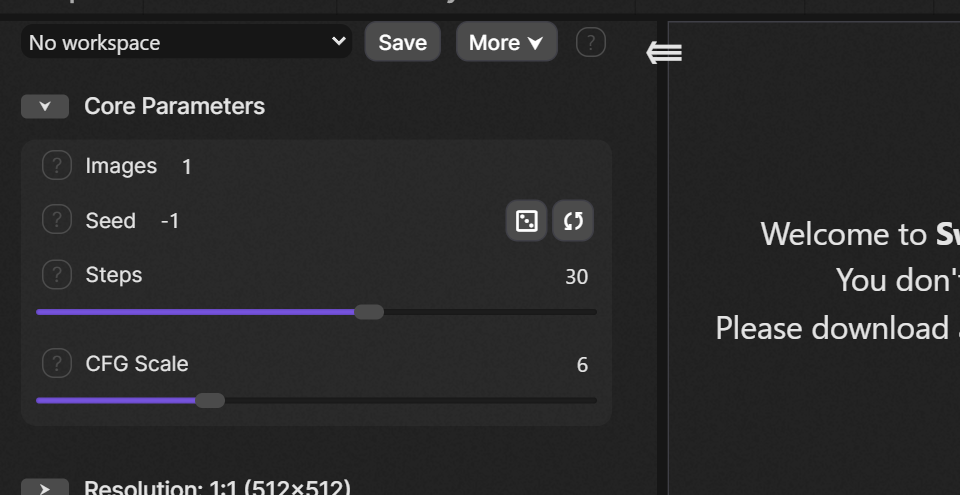
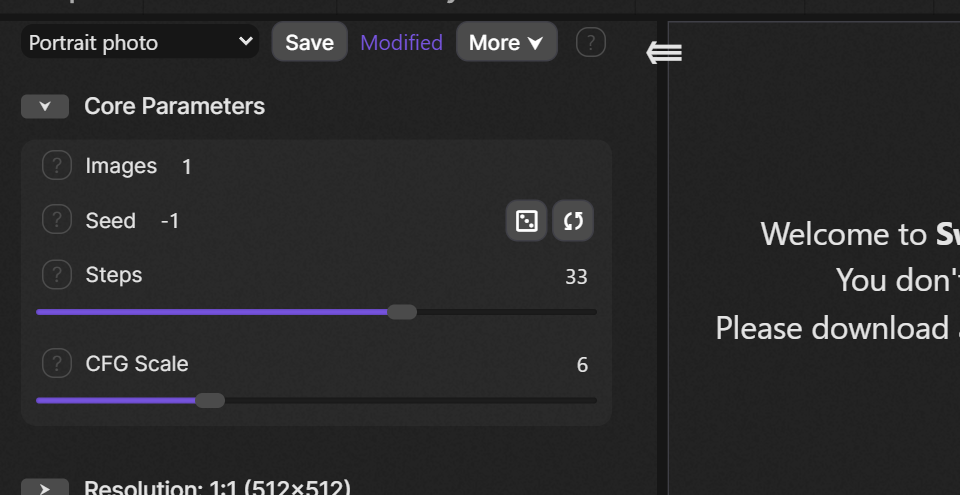
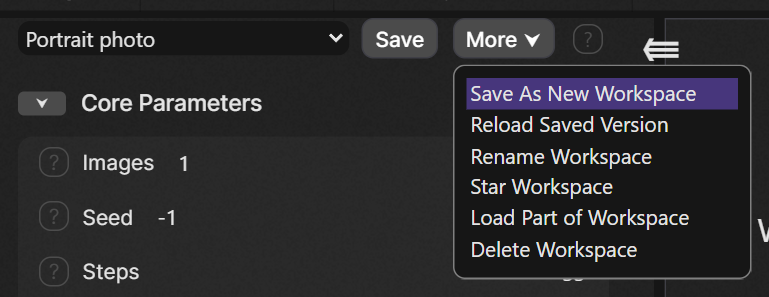
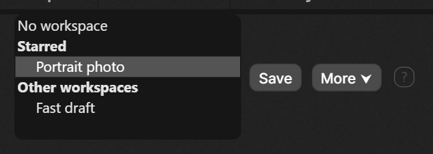
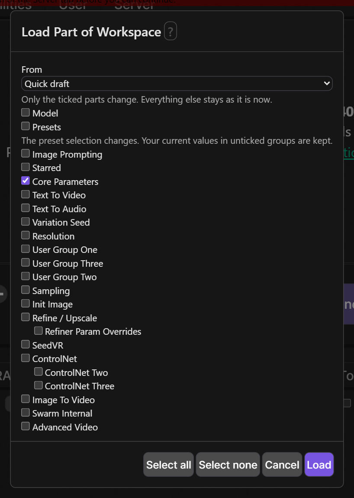
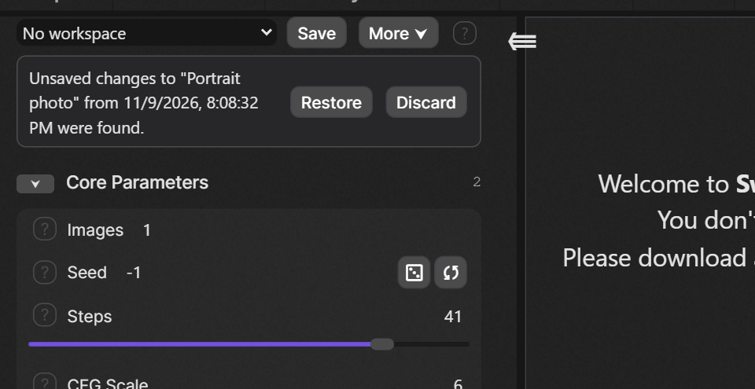
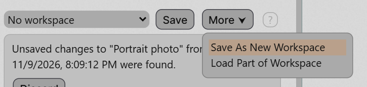

# SwarmUI-Workspaces

Save your whole Generate tab as a named **workspace**, and switch between setups in one step: every setting, which settings and groups are switched on, and which presets are active.

**Workspaces and presets.** A preset sets only the parameters you ticked and stacks on top of what you have. A workspace replaces everything. Use presets for reusable tweaks and workspaces to jump between whole setups. Workspaces use presets, never replace them: a workspace remembers which presets were active and re-selects them when loaded.

## Status

Early release. Everything described below works. It has been tested by hand in the browser against a SwarmUI dev build; there are no automated tests yet, so please report anything odd.

## Installation

Clone into your SwarmUI extensions folder, then restart SwarmUI:

```bash
cd SwarmUI/src/Extensions
git clone https://github.com/HartsyAI/SwarmUI-Workspaces.git Workspaces
```

## Tutorial: your first workspace

A new row sits at the top of the parameter list on the Generate tab. From left to right: a dropdown of your workspaces, **Save**, **More**, and a **?** help button.

### 1. Set up the Generate tab the way you like it

Choose your model, steps, CFG scale, switch groups on or off, pick presets. Nothing is saved yet, so the dropdown says **No workspace**.



### 2. Save it

Click **Save**. Your browser asks for a name. Type one, for example `Portrait photo`. The new workspace is created and selected in the dropdown.


### 3. Change something, then save or discard

Change any setting. A **Modified** marker appears, because your settings now differ from the saved workspace.



- Click **Save** (or press **Shift+S**) to keep the changes.
- Or just pick another workspace, or choose **More > Reload Saved Version**, to throw the changes away. You are asked first.

### 4. Make a variation without touching the original

Change settings the way you want the variation, then open **More** and choose **Save As New Workspace**. Give it a name, for example `Fast draft`. The original stays exactly as it was.



### 5. Switch between workspaces

Open the dropdown and pick another workspace. Your current settings are replaced completely by the saved ones. If the current workspace has unsaved changes, you are asked before they are discarded.

### 6. Star your favorites

Choose **More > Star Workspace**. Starred workspaces are listed first, under **Starred**, and the rest are under **Other workspaces**. (With nothing starred, the list is flat.)



### 7. Load only part of a workspace

Choose **More > Load Part of Workspace**. Pick a workspace, then tick only the parts you want: the model, the presets, or any group of settings. Everything you leave unticked stays exactly as it is now. The settings then show as **Modified**, because they no longer match any single workspace.



### 8. If you close the tab by accident

While you have unsaved changes, a draft is kept in your browser. When you come back, a notice offers to **Restore** it or **Discard** it. Restoring loads the workspace and puts your unsaved changes back on top; nothing is saved until you press **Save**.



### 9. Stuck? Click the ?

The **?** next to the toolbar explains every control in plain language, and the Load Part dialog has its own **?**.


## Reference

- **Dropdown**: a standard SwarmUI dropdown. Choosing a workspace replaces your current settings completely. With no workspace selected, **Save** asks for a name and creates one.
- **Save** writes the current settings into the selected workspace. **Shift+S** does the same, except while you are typing in a field, or a dialog or the image editor is open. If the workspace was changed somewhere else (another tab or browser), nothing is overwritten and you are told.
- **Modified** appears when the settings differ from the selected workspace, and goes away only after a successful save or load.
- **More**:
  - **Save As New Workspace**: copy your current settings into a new workspace, leaving the selected one as it is. The copy is not starred.
  - **Reload Saved Version**: discard unsaved changes and load the latest saved version.
  - **Rename Workspace**.
  - **Star Workspace** / **Unstar Workspace**.
  - **Load Part of Workspace**.
  - **Delete Workspace**: removes the saved workspace. Your current settings stay as they are.
- **Colors and themes**: the toolbar uses SwarmUI's own controls and theme colors, so every theme just works.



- **Phones**: on a narrow screen SwarmUI keeps the whole parameter panel hidden until you open it; the toolbar is at the top of that panel, like on desktop.

## What a workspace saves, and what loading does

A workspace saves the Generate tab's parameter values (including values you have configured but switched off), each parameter's own on/off switch, every parameter group's switch (nested groups too), and the active presets in order. Loading replaces all of that; it is not a merge like a preset.

Not saved: image, audio and video inputs (init image, mask, reference images), custom Comfy workflows, prompt attachments, and image editor state. A seed set to random (-1) is saved as -1, so it still picks a new seed each time. A workspace cannot bring back a model or preset that no longer exists.

Loading is careful:

- It checks the whole workspace first, and refuses a workspace from a newer version of this extension.
- It refuses to load while a custom workflow, init image, mask or the image editor is in use, because loading would leave that state in place. Nothing is changed.
- If the workspace's model is not available, it refuses and nothing is changed.
- If a saved preset is missing or has changed since, it asks before continuing.
- It never reports success when something was skipped: items that could not be restored are listed.
- If an error happens part-way, it puts your previous settings back. If even that fails, a notice above the parameters says the settings are a mix and should be checked.

## Limits and permissions

- Per user: up to 200 workspaces, each snapshot up to 256 KB, 4 MB of workspaces in total, names up to 100 characters. Names are plain text: control characters, line breaks and text-direction overrides are refused. A name is only ever a label, never a file path.
- Listing, saving and deleting workspaces needs the permission "[Workspaces] Manage Workspaces", which regular users have by default.
- If SwarmUI runs with `--no_persist`, nothing can be saved, and saving says so instead of pretending to work.

## Data and connections

- Workspaces are stored per user on the SwarmUI server, in that user's own generic data (keyed by their account ID), which is SwarmUI's standard place for an extension's per-user data. The server takes the user from the logged-in session on every request and never from anything the browser sends, so one account cannot list, read, change or delete another account's workspaces, and there is no sharing feature. Each save is read back to confirm it was really stored; if SwarmUI skipped the write, you are told instead of seeing a false success.
- While you have unsaved changes, a draft of them (which includes your prompts) is kept in your browser's local storage, under a key for that server and your account. It is never offered to another account, nothing is written before SwarmUI has told the page who you are, and drafts older than 14 days are removed. On a shared computer, finish with Save or Discard, or use a private window.
- The extension makes no external network connections.
- Earlier builds could also store folders, tags and thumbnails. They are no longer used or shown, and any leftover data is harmless.
- Workspaces are stored in SwarmUI's account database, so they are lost if that database is lost, and anyone who can read that database (a server administrator) can read them, as with all SwarmUI account data.

## License

MIT. See [LICENSE](LICENSE).
